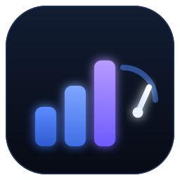

<p align="center"></p>
<h1 align="center">dsh-effort-pilot</h1>

<p align="center"><a href="https://www.npmjs.com/package/dsh-effort-pilot"></a> <a href="https://github.com/atlasmarkz/dsh-effort-pilot/releases"></a> <a href="LICENSE"></a></p>

> **The money line (measured):** thinking tokens are billed as output. On this machine (OpenCode Go, DeepSeek V4.1 Flash, DSH 0.2.2-alpha.2), dropping the same task from `max` to `low` cut output tokens by **~36%**, decode time by **~38%** and wall clock by **~33%**. A 30-step session saves roughly 3k–10k output tokens — about **$0.002–0.006** on Flash and **$0.005–0.020** on V4 Pro. The speed win is the bigger one; more expensive or more thinking-heavy models save proportionally more. Method and raw numbers: [BENCHMARK.md](BENCHMARK.md).

A per-step **thinking-effort pilot** for DeepSeek Harness (DSH): cheap tool rounds drop a level, failures and heavy work lift one, and the agent can adjust its own depth with `set_effort` — **without ever switching models**, so the prompt prefix and its cache stay intact.

## Install

```bash
dsh plugin --profile web add dsh-effort-pilot
# or from GitHub: dsh plugin --profile web add github:atlasmarkz/dsh-effort-pilot
# local dev: dsh plugin --profile web add /absolute/path/to/dsh-effort-pilot
```

Restart DSH. Zero dependencies, no build step.

## Model support

The pilot is not tied to a model: the ladder comes from the route's adapter-declared `reasoning.efforts`.

- ✅ **Two or more declared levels** (e.g. OpenCode Go's DeepSeek V4.1 Flash declares `low / high / max`): automatic scheduling and `set_effort` both work.
- ⚠️ **One declared level** (some models only expose `max`): the pilot leaves it alone; `set_effort` answers with the declared list.
- ⚠️ **Toggle-only models** (`off`/`on`): there is no ladder to move, so they are out of scope.
- After switching models, ask the agent to call `effort_status` once — its `declared levels` is the authoritative answer.

## How it decides

| Situation | Action |
|---|---|
| 2 consecutive simple, small tool rounds | lower one level, never below `floor` |
| failed tools, heavy payloads, mixed heavy work | raise one level (or to `high` / `max`) |
| right after a change | hold for `holdSteps` rounds (anti-flapping) |
| last turn ended in `EMPTY_RESPONSE` / `TIMEOUT` etc. | raise one level next turn (rate limit / auth / quota excluded) |
| you picked another level manually | automatic scheduling pauses; `set_effort auto` hands it back |

Only `reasoningEffort` moves; provider/model are copied. Changes apply from the next model step.

## Configuration

Override in your profile's `cordis.patch.yml`:

```yaml
- id: effort-pilot
  config:
    floor: low          # lower bound of automatic downgrades
    simpleStreak: 2     # consecutive simple rounds before one downgrade
    holdSteps: 1        # rounds a fresh change is held
    allowUpgrade: true  # allow failure/heavy-work upgrades
    verbose: false      # log every decision
```

All keys and defaults live in [`lib/config.js`](lib/config.js); unknown keys fail at mount time.

## Tools

- **`set_effort`** — the agent changes its own depth with a mandatory reason; `{ "level": "auto" }` hands control back.
- **`effort_status`** — current level, declared levels, remaining hold, recent decision ledger.

## Cost estimate (measured)

From the local benchmark (see [BENCHMARK.md](BENCHMARK.md); n=2, gateway noise visible):

- reasoning task: `max` → `low`, output tokens **3,700 → 2,362 (-36%)**, decode 47.8 s → 29.5 s, wall clock 71.4 s → 47.6 s;
- mechanical task: after the pilot's downgrade, output tokens **1,216 → 763 (-37%)**, decode 9.4 s → 3.9 s.

Projected to a 30-step session: ~3k–10k output tokens saved, i.e. **$0.002–$0.006** per task on Flash and **$0.005–$0.020** on V4 Pro (output `$1.98/M`). Formula: **share of downgraded steps × thinking tokens saved per step × output price**. The speed win is the more direct one (about -33% wall clock); more expensive or thinking-heavy models save more.

**Quality:** two tasks (fix a failing suite, blind-reviewed code review), two runs per arm — all three arms passed 6/6 on the fix with the test file untouched, and blind judge scores were max 9.0 / auto 9.0 / low 10.0 (n=2, no measurable difference; see [BENCHMARK.md](BENCHMARK.md)).

## Development

```bash
node --test   # 41 tests; use node --test --test-isolation=none in restricted sandboxes
```

Extension-point research, rejected alternatives, the full config and the roadmap live in [DESIGN.md](DESIGN.md); the market entry is in [`submission/`](submission/).

MIT
