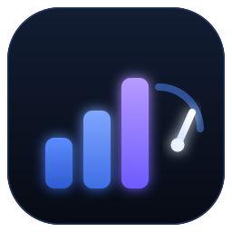

<p align="center"></p>
<h1 align="center">dsh-effort-pilot</h1>

<p align="center"><a href="LICENSE"></a></p>

> **一句话算账：** 思考 token 按输出价计费。把 60% 的简单工具轮从 `max` 降到 `low`，一个 30 步任务约省 **3 万输出 token**——OpenCode Go 的 V4.1 Flash 约 **2 美分/任务**、V4 Pro 约 **6 美分/任务**（每天 20 个这样的任务 ≈ 每月省 **$11 / $37**），总耗时也一起下降。算法见[成本估算](#成本估算)。

> 收录条目已准备好（见 [`submission/`](submission/)），提交进社区插件目录 **awesome-dsh-plugin**（DSH 插件市场的数据源）后即可在市场里搜到。

为 DeepSeek Harness（DSH）设计的**逐步思考强度驾驶仪**：便宜的工具体力活保持便宜，失败自动升档，模型还能用 `set_effort` 自己调节——**全程不换模型**，因此提示词前缀和上游缓存都不受影响。

```text
一轮任务:  [用户提问] → 第1步 (max) → read/write ×2（小载荷）→ 第2步 (high) → … → 工具失败 → 第N步 (max)
                              自动降一档                          自动升一档
```

## 为什么需要它

Agent 写代码时，等待时间主要花在“每次工具调用前重新思考”上。开 `max` 档做 30 步任务，光在便宜的读文件之间思考就要好几分钟。已有插件各解决一角：

| 已有插件 | 可借鉴之处 | 局限 |
|---|---|---|
| `dsh-thinking-levels` / `dsh-tool-turbo` | 按工具轮次自动调度（简单工具→低档） | 一个按 rc 精确钉版本，一个是 GitHub-only 且没有设置界面 |
| `dsh-router-laya`、`@zengevent/dsh-effort-dial` | 失败 / 重试后自动升档 | 一个要跑本地分类模型，另一个偏 UI |
| `dsh-set-model` | 让 Agent 自主切换模型与档位 | 换模型会破坏 KV cache；自动模式依赖外部决策服务 |
| `dsh-turbo` | 会话级档位 | 改的是规划/验证策略，不是逐步档位 |

`dsh-effort-pilot` 取其中最有用的 80%：**逐步自动调度 + 失败升档 + Agent 可见的控制**，并立一条硬规矩——**永远不换模型**。只有 `reasoningEffort` 在动，所以上游前缀缓存得以保留。

它同时瞄准**当前** DSH 的扩展面：在 DSH `0.2.x` 上，`agent/request` 监听器已经不能改路由或档位（agent loop 会抛 `use agent.model.select() before step preparation`）。本插件写的是 `model/selection` 事件，这是受支持、且缓存安全的路径。

## 成本估算

不是营销数字，是明确假设下的算术：

- 一个 30 步任务；`max` 每步约 2,500 个思考 token，`low` 约 800 个（随模型与任务浮动）；
- 60% 的步骤是简单工具轮、被降到 `low`：省下 18 × 1,700 ≈ **30,600 个输出 token**；
- 思考 token 按输出 token 计费（OpenCode Go 目录价）：V4.1 Flash `$0.60/M` → **≈ $0.018/任务**；V4 Pro `$1.98/M` → **≈ $0.061/任务**；
- 每天 20 个这样的任务：Flash ≈ **$11/月**，V4 Pro ≈ **$37/月**。

实际节省 = **降档步骤占比 × 每步省下的思考 token × 输出单价**。用 DSH 自带的 token 统计和 `effort_status` 的决策台账，校准你自己工作负载下的真实比例；模型越贵、会话越长，省得越多。缓存读取本身很便宜，这个插件的节省来自**少生成**思考 token，而不是多命中缓存。

## 安装

要求：DSH ≥ `0.2.0-rc.1`（已按 0.2.x 的 `agent/request` 校验行为验证）。无构建步骤、无运行时依赖，纯 ESM。

```bash
# 从 GitHub
dsh plugin --profile web add github:atlasmarkz/dsh-effort-pilot

# 从 npm（发布后同名包）
dsh plugin --profile web add dsh-effort-pilot

# 本地开发（绝对路径）
dsh plugin --profile web add /absolute/path/to/dsh-effort-pilot
```

首次安装后重启 DSH（bundle 层在启动时组装）。卸载：`dsh plugin --profile web remove dsh-effort-pilot`。

## 工作方式

三个部件协作，不 import 任何 `@deepseek-ai/*` 包：

1. **监听器** —— 一个 `session/event` 监听把会话自己的日志折叠成：当前选择、每步的工具调用/结果、手动覆盖。不复制状态，会话日志就是唯一事实来源。
2. **调度器** —— 每轮工具结束后，用一个小而纯的策略函数算出下一档，然后写 `model/selection`：**provider/model 原样复制**，只改 `reasoningEffort`。DSH 在准备下一步时会读取该选择——这正是“任务内换挡”。
3. **工具** —— `set_effort` 让模型自己调档（必须给出审计理由）或交回 `auto`；`effort_status` 报告当前路由、模型声明的档位与模式。

### 决策规则

| 情况 | 动作 |
|---|---|
| 新提示词 / 本轮没有工具调用 | 保持当前档位 |
| 连续 2 轮 ≥75% 简单小工具 | 降一档（不低于 `floor`） |
| 任一工具调用失败 | 升一档 |
| 工具参数 ≥ 32 KB | 升到 `heavyLevel`（`max`） |
| 混合 / 重活 | 升到 `mixedLevel`（`high`） |
| 刚自动改过档 | 接下来 `holdSteps` 轮内不再自动改（防横跳） |
| 上一轮以白名单内的模型请求错误结束 | 下一轮开头升一档（`RATE_LIMIT` / `AUTH` / `QUOTA` 不算，见配置） |
| 你自己手动选了同模型的其它档位 | 本会话暂停自动调度 |
| 切换模型/路由 | 适配新模型的档位表，继续自动调度 |

每轮最多自动调整 `maxAutoChangesPerTurn` 次，防止病态循环来回横跳；每次改档还会记入决策台账，可用 `effort_status` 回看。

## 配置

在 profile 的 `cordis.patch.yml` 里覆盖同一个插件 id：

```yaml
- id: effort-pilot
  config:
    enabled: true
    auto: true
    allowDowngrade: true
    allowUpgrade: true
    floor: low                 # 自动降档的下限
    simpleRatio: 0.75          # 简单调用占比达到多少算一轮“简单轮”
    simpleStreak: 2            # 连续几轮简单轮后降一档
    smallPayloadBytes: 8192
    heavyPayloadBytes: 32768
    mixedLevel: high
    heavyLevel: max
    maxAutoChangesPerTurn: 6
    holdSteps: 1               # 改档后保持几轮不再自动改，防横跳
    decisionMemory: 8          # 每会话保留多少条决策台账
    escalateOnTurnError: true  # 模型请求错误结束后，下一轮升一档
    escalateOnCodes: [EMPTY_RESPONSE, MALFORMED_RESPONSE, SERVER, TIMEOUT]  # 只有这些错误码算“想得不够”
    simpleTools: [read, grep, glob, write, edit, todo_write, job_output]
    toolName: set_effort
    verbose: false
```

| 键 | 默认 | 含义 |
|---|---|---|
| `enabled` | `true` | 自动调度总开关（工具仍可用） |
| `auto` | `true` | 逐步调度；`false` = 只用工具模式 |
| `allowDowngrade` / `allowUpgrade` | `true` | 是否允许降 / 升 |
| `floor` | `low` | 自动降档下限 |
| `mixedLevel` / `heavyLevel` | `high` / `max` | 升档目标 |
| `simpleRatio` / `simpleStreak` | `0.75` / `2` | 简单轮降档速度 |
| `smallPayloadBytes` / `heavyPayloadBytes` | `8192` / `32768` | 载荷阈值（按参数文本长度估算） |
| `maxAutoChangesPerTurn` | `6` | 每轮安全上限 |
| `holdSteps` | `1` | 改档后保持几轮不再自动改；`0` 关闭 hold |
| `decisionMemory` | `8` | 每会话保留的决策台账条数 |
| `escalateOnTurnError` / `escalateOnCodes` | `true` / 见上 | 模型请求失败后是否升档；只有白名单错误码算“想得不够”，限流/鉴权/额度/传输错误被排除 |
| `simpleTools` | 见上 | 简单确定性工具；shell 工具被刻意排除 |
| `toolName` | `set_effort` | Agent 控制工具名 |
| `verbose` | `false` | 在宿主控制台打印每次决策 |

配置严格校验：写错键名会在挂载时直接报错，而不是“插件静默不工作”。

### 给“Max 党”的起点（例如 OpenCode Go + DeepSeek V4.1 Flash）

该模型声明 `low / high / max` 三档。推荐起步：

```yaml
- id: effort-pilot
  config:
    floor: low
    simpleStreak: 2
    allowUpgrade: true
```

跑一个正常任务：简单的读写循环会逐渐降到 `low`，工具失败或大改会拉回 `high`/`max`。如果不想低于 high，把 `floor` 设成 `high` 即可。

## 工具

### `set_effort`

```json
{ "level": "max", "reason": "并发丢单问题，需要更深推理" }
```

档位会按当前模型声明校验；不支持时返回声明列表且不改任何东西。`{ "level": "auto" }` 把控制权交回驾驶仪。改档从下一个模型步生效。

### `effort_status`

返回 provider/model、声明的档位、当前档位、是否自动模式、本轮已自动调整次数、hold 剩余轮数，以及最近的决策台账（`from → to (reason)`）。模型不确定自己在什么深度、为什么被改档时，可以随时低成本自查。

## 行为说明

- **改档是“步粒度”的。** DSH 在准备一步时固定选择，所以决策落在下一步，绝不会打断正在流式输出的请求。
- **只动档位。** provider/model 从当前选择原样复制；切换模型明确不在范围内（这才能保住缓存）。
- **手动优先。** 同模型下手动选了别的档位，本会话自动调度暂停，直到模型调用 `set_effort { level: "auto" }` 或会话结束。
- **子代理会话**也是普通会话，同样生效；不想这样就把 `auto` 设为 `false`。
- **不联网、不写文件、不额外持久化**（除会话日志与内存中的决策簿记外）。

## 开发

```bash
node --test                          # 40 个测试：策略、配置、调度器、插件装配
node --test --test-isolation=none    # 受限沙箱里进程内跑
```

策略是纯函数；调度器用假 Session（实现 `id`、`snapshotEvents()`、`append()`、`requestHeader()`）测试，不需要装 DSH 就能跑测试。

扩展点调研、被否决的方案与路线图见 [DESIGN.md](./DESIGN.md)。

## 开源清单

1. 仓库名 / npm scope 随意改；`package.json` 故意没写 owner 字段。
2. `npm publish`（可能需要 2FA，包是公开的）。
3. 补上 GitHub 地址、CI 徽章；做了客户端半之后再加截图。
4. 本包里的 `cordis.patch.yml` 是 bundle 层；改 `id` 要写迁移说明。

## 致谢

站在这些项目的观察之上：

- [dsh-tool-turbo](https://github.com/Electricitysheep/dsh-tool-turbo) 与 [dsh-thinking-levels](https://github.com/drscrewdriver/dsh-thinking-levels) —— 简单工具轮调度；
- [dsh-router-laya](https://github.com/HapyRain/dsh-router-laya) 与 [dsh-effort-dial](https://github.com/zengxiaolou/dsh-effort-dial) —— 失败/重试升档；
- [dsh-set-model](https://github.com/john-walks-slow/dsh-set-model) —— Agent 可见控制与审计理由。

## 许可证

MIT
